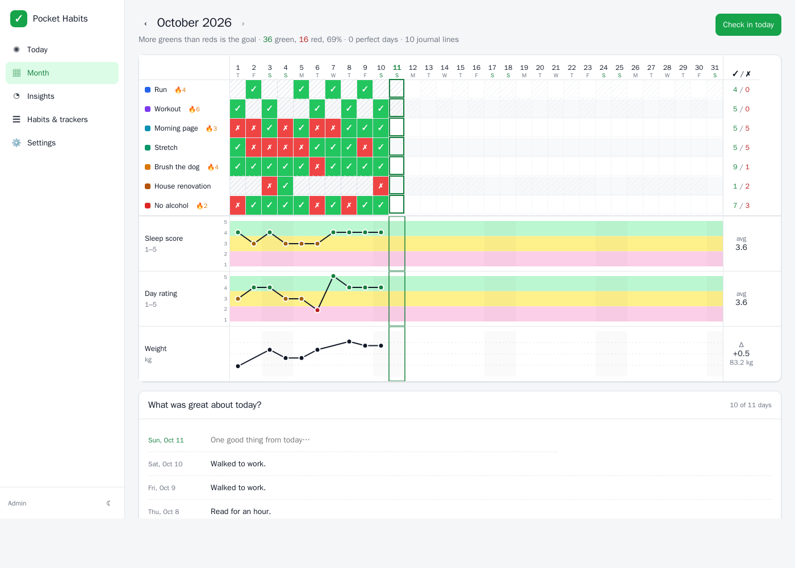
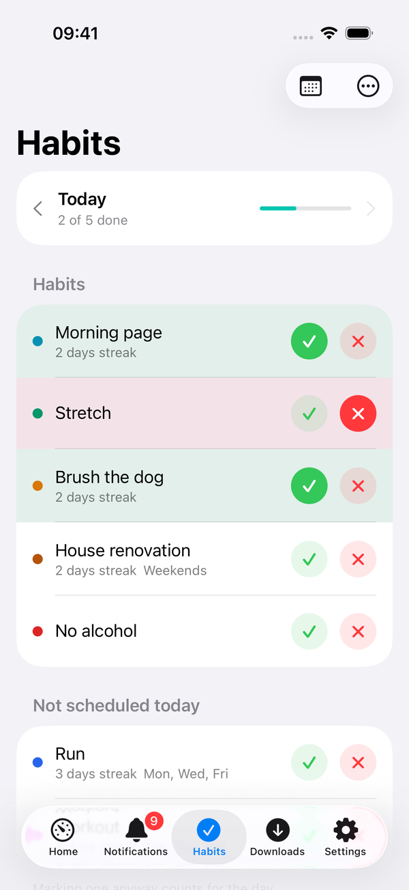
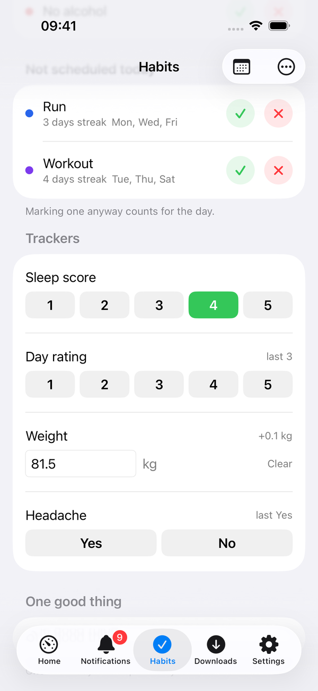
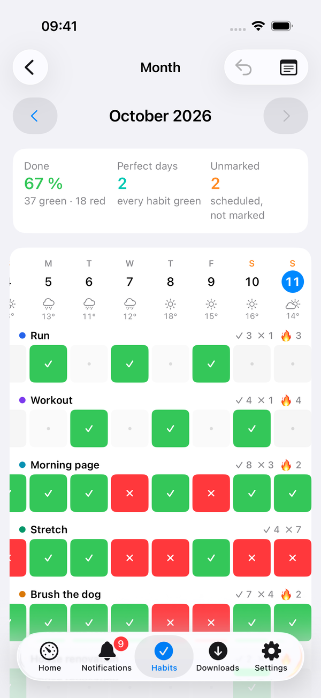
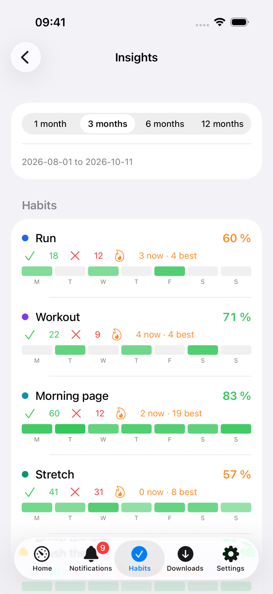
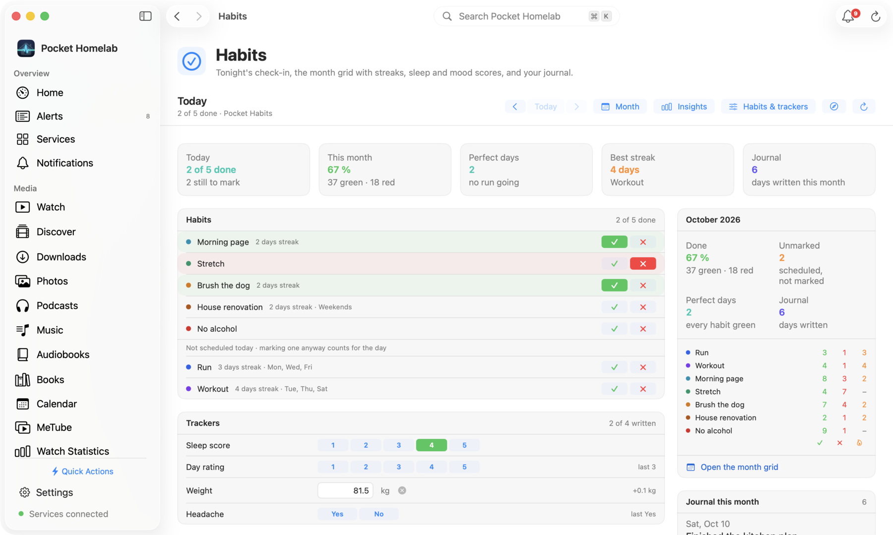

<p align="center">
  
</p>
<h1 align="center">Pocket Habits</h1>
<p align="center">
  A self-hosted habit tracker that copies the one-page bullet-journal spread that actually sticks.<br>
  <b>One binary · one SQLite file · one volume.</b> No Postgres, no Redis, no gamification.
</p>
<p align="center">
  <a href="https://github.com/abjelosevic88/pocket-homelab-habit-tracker/actions"></a>
  <a href="https://github.com/abjelosevic88/pocket-homelab-habit-tracker/pkgs/container/pocket-homelab-habit-tracker"></a>
  <a href="LICENSE"></a>
  
</p>

---

Most habit trackers fail because they become another habit you can't stick to. This one is the digital version of a notebook spread that takes five minutes to set up and one minute a night to fill in:

- **Seven habits, two pens.** A month grid with the days across the top and your habits down the side. Click once for green (did it), twice for red (didn't). The aim is more greens than reds. Swap habits out at the end of a month when they stop being relevant.
- **Sleep score and day rating out of five**, drawn as a line over three highlighter bands, so you can *see* how sleep and mood line up with what you did or didn't do.
- **A weight row** (or steps, hours, anything with a number).
- **One good thing per day.** A single line of gratitude journal next to the grid. Optionally one bad thing too (Settings → General).
- **Important days.** A note for a day you want to remember (Today, or click a date on the month grid); the date turns red on the month page and the month lists them.

On the go, **[Pocket Homelab](https://pockethomelab.com/)** is its companion app for iPhone, iPad, Mac and Android: tonight's check-in, the month grid and your streaks in your pocket. See [Companion app](#companion-app-pocket-homelab).

<p align="center"></p>

## Features

| Area | What you get |
|---|---|
| **Month page** | The whole month on one screen: habit grid with weekday letters, weekends tinted, today highlighted, per-habit ✓/✗ counts and streaks. Scale trackers over green/yellow/pink bands, number trackers as an auto-scaled line. Arrow keys flip months. |
| **Today check-in** | Big ✓ / ✗ buttons, 1–5 pills, a number field with the change since last time, the journal box. Mobile-first, installable as a PWA, bottom tab bar on phones. |
| **Habits** | Scheduled days per habit (Mon/Wed/Fri runs don't count as missed on Tuesday), colours, ordering, start/end dates. *End* a habit and it stays on this month's page but is gone from the next. History is always kept. |
| **Trackers** | Any 1–5 (or 0–10) score, any measurement with a unit, or a yes/no question ("Headache?"). "Higher is better" or "lower is better" decides which end gets the green band. |
| **Insights** | Completion rate, current and best streak, rate per weekday, 7-day moving averages, and *what moves your scores*: average sleep score / day rating on days a habit was green vs red, or a yes/no question was yes vs no. |
| **Weather** | The day's weather from Open-Meteo (no key) for your home location — or for where your phone was, when Pocket Homelab or a Shortcut posts it to `/api/v1/location` once a day. A strip on the month page, a line on the check-in, and *Weather and your scores* in Insights: your scores and habit rate by condition, temperature band and daylight hours. |
| **Reminder** | One push a day at a time you choose, only if something is still unmarked. ntfy, Apprise or any JSON webhook. |
| **Automation** | REST API with personal tokens, a single `POST /api/v1/checkin` for iOS Shortcuts / Home Assistant / n8n, `/api/v1/dashboard` for Homepage widgets, Prometheus `/metrics`, `/healthz` + `/readyz`. With **Pocket Core** on the box: registers itself, publishes `habits.marked` / `habits.unmarked` / `habits.tracked` / `habits.checkin`, accepts paired-phone tokens, and offers **Sign in with Pocket Core** on the login page with no configuration (the app receives its OpenID Connect client when it registers). |
| **Ops-friendly** | Single static binary, embedded SPA, SQLite with WAL, `VACUUM INTO` backups from the UI/CLI/API, JSON + CSV export, JSON import, proxy auth, non-root container, dark mode. |

## Quick start

```bash
mkdir pocket-habits && cd pocket-habits
curl -O https://raw.githubusercontent.com/abjelosevic88/pocket-homelab-habit-tracker/main/docker-compose.yml
docker compose up -d
```

Open `http://<host>:8080`, create your account, add up to seven habits under **Habits & trackers**, and check in tonight.

<details>
<summary><b>docker run one-liner</b></summary>

```bash
docker run -d --name pocket-habits -p 8080:8080 -v $PWD/data:/data \
  -e TZ=Europe/Berlin -e BASE_URL=https://habits.example.com \
  ghcr.io/abjelosevic88/pocket-homelab-habit-tracker:latest
```
</details>

<details>
<summary><b>Try it with demo data</b></summary>

```bash
docker run --rm -p 8080:8080 -e DEMO_DATA=true -e AUTH_MODE=none ghcr.io/abjelosevic88/pocket-homelab-habit-tracker:latest
```
Seven habits and ~70 days of history, no login.
</details>

<details>
<summary><b>Bare metal / systemd</b></summary>

Download a binary from the [releases page](https://github.com/abjelosevic88/pocket-homelab-habit-tracker/releases), drop it in `/usr/local/bin`, and use [`deploy/systemd/pocket-habits.service`](deploy/systemd/pocket-habits.service).
</details>

## Configuration

Everything is an environment variable with a sensible default. The important ones:

| Variable | Default | Notes |
|---|---|---|
| `TZ` | `UTC` | Decides what "today" is and when the reminder fires. Set it. |
| `BASE_URL` | – | Used in reminder links. |
| `DATA_DIR` | `/data` | Database and backups live here. |
| `AUTH_MODE` | `local` | `local` (built-in login), `proxy` (trust `Remote-User` from Authelia/Authentik/Tinyauth), `none` (single user, no login — LAN only!). |
| `ADMIN_EMAIL` / `ADMIN_PASSWORD` | – | Create the first user without the setup screen. |
| `SECURE_COOKIES` | `false` | Set `true` behind HTTPS. |
| `DEMO_DATA` | `false` | Seed sample habits and history into an empty database. |

Full list in [docs/configuration.md](docs/configuration.md). Reverse-proxy snippets in [docs/reverse-proxy.md](docs/reverse-proxy.md).

## Automation

Create a token under **Settings → API tokens**, then:

```bash
# tonight's check-in from an iOS Shortcut, Home Assistant, n8n …
curl -X POST https://habits.example.com/api/v1/checkin \
  -H "Authorization: Bearer ph_…" -H "Content-Type: application/json" \
  -d '{"habits":{"1":1,"2":-1},"trackers":{"1":4,"3":81.2},"journal":"Long walk by the river."}'

# compact status for a Homepage / Glance widget
curl -H "Authorization: Bearer ph_…" https://habits.example.com/api/v1/dashboard
# → {"today_done":3,"today_total":5,"month_rate_pct":78,"perfect_streak":4,…}
```

Everything else is in [docs/api.md](docs/api.md), including a Homepage `customapi` widget and an ntfy reminder example.

## Companion app: Pocket Homelab

[Pocket Homelab](https://pockethomelab.com/) is a native app for iPhone, iPad, Mac and Android that talks to self-hosted services, and Pocket Habits is one of them. It connects with an API token and gives you:

| Area | What you get |
|---|---|
| **Check-in** | Today (or any earlier day) with a ✓ and ✗ for every habit, the scores as pills, the number with its change since last time, Yes / No questions, the day's weather and the journal line. Opened once a day it can send the phone's location, so the weather follows you. A **Habits** tab, and a Home card with today's progress, the month's rate and the perfect streak. |
| **Month** | The month grid: habits down the side, days across the top, tap a cell to mark it; counts and streaks per habit; the trackers as a line over the three bands; the journal. |
| **Insights** | Rates, streaks and weekday heat per habit, each tracker's average and line, and what moves your scores. |
| **Habits & trackers** | Add, edit, reorder, end this month, resume or delete habits and trackers from the phone. |
| **Settings** | Pocket Habits' own settings from the phone or the Mac: the title, week start and landing page, the journal prompts, and the reminder (time, ntfy / Apprise / webhook, a test). |

Setup:

1. In Pocket Habits, create a token under **Settings → API tokens** (it starts with `ph_` and is shown once).
2. In Pocket Homelab, open **Settings → Services → Pocket Habits** and enter the base URL (e.g. `https://habits.example.com`) and the token, then **Test connection**.
3. Turn on the **Habits** tab in **Settings → Tabs**.

The token is kept in the device's secure store (the Keychain on Apple devices). Details: [pockethomelab.com/docs/services/habits](https://pockethomelab.com/docs/services/habits).

<p align="center">
  
  
  
  
</p>
<p align="center"><sub>Pocket Homelab on the iPhone: the check-in, the trackers and the journal, the month grid, the insights.</sub></p>
<p align="center"></p>
<p align="center"><sub>The Habits workspace on the Mac.</sub></p>

## Backups

The database is a single file. Use whichever you like:

- **UI:** Settings → Backup & data → *Download database* (a consistent `VACUUM INTO` copy). The file holds everybody's data, so the download is offered only to the admin of a single-account box; once other people have accounts, use the CLI on the host (everyone can still export their own data as JSON/CSV).
- **CLI:** `docker exec pocket-habits pocket-habits backup` writes to `/data/backups/`.
- **API:** `GET /api/v1/backup` (same rule as the UI).
- **Export:** JSON (re-importable) or CSV.

Restic / Borg / Backrest users: back up `DATA_DIR`, but snapshot the live `pocket-habits.db` through one of the above rather than copying the WAL files raw. See [docs/backup.md](docs/backup.md).

## Development

```bash
make dev      # Go API on :8080 (demo data, no login) + Vite on :5173
make test     # go vet + go test + tsc
make all      # production build: web UI embedded into ./pocket-habits
```

Go 1.22+ and Node 20+. Stack: Go + chi + modernc SQLite (no CGO), React 19 + Vite + TypeScript, no UI framework, no chart library.

## Credits

The system is from ODHD's video [*I Finally Made Habit Tracking Simple*](https://www.youtube.com/watch?v=_OutCeU5WL4). Pocket Habits just makes it a web page. Sibling projects: [Pocket Invoicing](https://github.com/abjelosevic88/pocket-homelab-invoicing), [Pocket Inventory](https://github.com/abjelosevic88/pocket-homelab-inventory), [Pocket Bookshelf](https://github.com/abjelosevic88/pocket-homelab-bookshelf), [Pocket Split](https://github.com/abjelosevic88/pocket-homelab-cost-split) and [Pocket Subtitles](https://github.com/abjelosevic88/pocket-homelab-subtitles).

## License

MIT
